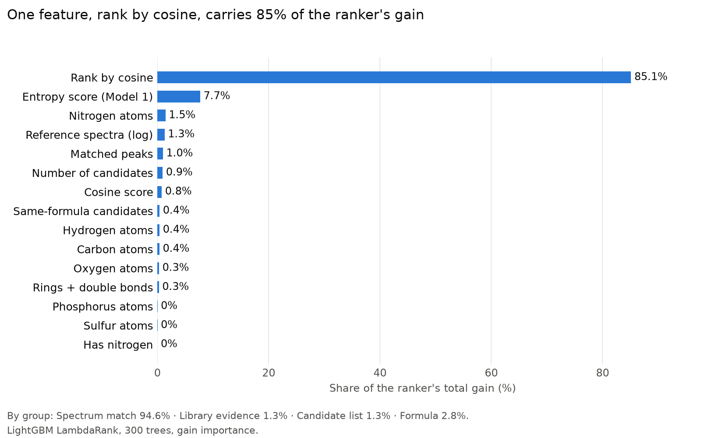
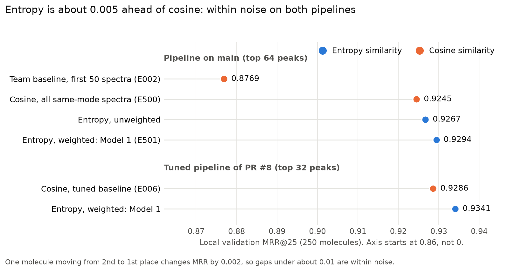

# Hand-off: @Mrnidhi

> Fill this in by **Wed Nov 25, 9 PM**. Anees copies it into the report and slides. Your task: [TASK.md](TASK.md)

## Models
| # | Model | File | Local MRR@25 | Top-1 | Top-10 | hide_true MRR (if used) | Kaggle score | Exp. ID |
|---|---|---|---|---|---|---|---|---|
| 0 | Baseline (library cosine) | src/models/base.py | 0.877 | 0.816 | 0.968 | 0.000 | | E002 |
| 1 | Entropy similarity (weighted), all same-mode reference spectra | members/Mrnidhi/model_entropy.py | 0.929 | 0.892 | 0.984 | not used | not submitted yet | E501 |
| 2 | LightGBM LambdaRank re-ranker, 15 features | members/Mrnidhi/model_ranker.py | 0.911 | 0.856 | 0.996 | not used | not submitted yet | E502 |
| 3 | | | | | | | | |

## Model 1: Spectral entropy similarity
- **What it is (2–3 sentences):** A library-search scorer like the baseline, but the match between two spectra is measured with spectral entropy similarity (Li et al., Nature Methods 2021) instead of cosine. Two spectra are mixed, and the less the entropy of the mix rises, the more alike they are. The scorer also compares against every reference spectrum of a candidate in the same ionization mode, where the E002 baseline only looked at the first 50.
- **Input → output:** the molecule's cleaned spectra and its candidate table → one score per candidate, between 0 and 1. A candidate's score is the mean, over the molecule's spectra, of the best similarity against any of that candidate's same-mode reference spectra.
- **Architecture:** no learned parameters. Each spectrum is prepared once: intensities squared back to raw scale (the shared cleaning square-roots them), peaks within 0.05 Da merged, peaks under 1% of the tallest dropped, intensities scaled to sum to 1, then the paper's entropy weighting (spectra with entropy below 3 get their small peaks raised). Peaks of two spectra match if they are within 0.02 Da. Similarity = 1/2 × the sum over matched peaks of f(a + b) − f(a) − f(b), with f(x) = x·log2(x). The formula is written in plain NumPy so the Kaggle notebook needs no extra package; `tests/test_entropy.py` checks it against the reference (plain Python) code of the `ms_entropy` package on 1,200 random spectrum pairs, including dense clusters of peaks. The package's compiled build merges dense clusters a little differently on about 0.3% of our library spectra; with either one the validation score is 0.9294.
- **Training:** none. Nothing is fitted, so there are no epochs, optimizer or learning rate, and no seed to fix. It runs on a laptop CPU: about 12 s for the 250 validation molecules and about 100 s for a full run from `test.parquet` to `submission.csv`, including building the reference library.
- **Result and interpretation:** local MRR@25 = 0.929 (top-1 89.2%), against 0.877 for the E002 baseline. Most of that gain comes from using all reference spectra, which is the same change as Anees's E004: cosine on the same spectra scores 0.9245 (E500). The entropy measure itself adds about 0.005. On the tuned pipeline of E006 (top-32 peaks) the picture is the same: 0.9341 for entropy against 0.9286 for cosine. A gap of 0.005 is inside the noise for 250 molecules (one molecule moving from 2nd to 1st changes MRR by 0.002), so the fair reading is that entropy similarity is slightly ahead of cosine in both settings but not clearly better. The 46 baseline misses were 91% isomers of the true structure, so a single similarity number seems to top out near 0.93, which is the reason for Model 2.

## Model 2: LightGBM LambdaRank re-ranker
- **What it is:** a learning-to-rank model. Each candidate is described by 15 numbers (features), and a LightGBM model trained with the LambdaRank objective turns them into one score. The candidates of a molecule are then sorted by that score.
- **What changed vs Model 1, and why:** Model 1 ranks by one number, the entropy similarity. Model 2 gets that number as one feature among others: the baseline cosine score and the candidate's rank by it, the number of peaks shared with the best-matching reference spectrum, log of the candidate's reference-spectra count, the number of candidates, the number of same-formula candidates, counts of C, H, N, O, S and P, a has-nitrogen flag, and rings plus double bonds from the formula. The idea was that a model can learn how much to trust each signal.
- **Architecture / training:** `lightgbm.LGBMRanker`, objective `lambdarank`, 300 trees, learning rate 0.05, other settings default, seed 0, deterministic mode. Training data is built "leave one library out" so the validation molecules are never used: molecules of msdial, massbank and mona are the unknowns (up to 3,000 per library, at most 8 spectra each, validation molecules removed, spectra with a precursor error above 20 ppm dropped as in the shared loader), their own library and the validation library are hidden from the reference, and the true structure is labelled 1 among the mass-matched candidates. Molecules whose true structure is not among the candidates are dropped. That gives 7,134 molecules and 260,519 candidate rows (2.7% positives). Building the table takes about 4 minutes and training a few seconds, on a laptop CPU.
- **Result and interpretation:** local MRR@25 = 0.911 (top-1 85.6%, top-10 99.6%). That is above the E002 baseline (0.877) but below Model 1 (0.929), which is one of its own features. The right answer lost first place on 12 validation molecules (10 of them to second place) and gained it on 3. The same holds on the training libraries when each is held out in turn: 0.9468 for the ranker against 0.9546 for the entropy score alone, so this is not a quirk of the 250 validation molecules. The feature-importance figure shows why: 85% of the ranker's gain sits on one feature, the rank by cosine. A tree model scores a candidate from its own row, so a feature that says where the candidate stands in its list is worth more than an absolute score, and the only such feature was built on the weaker baseline cosine. The formula features took under 3% of the gain, because isomers share a formula. The next step (Model 3) is to give the ranker the same rank and gap features for the entropy score.

## Model 3 (optional): <name>

## What didn't work, and why (required)
- **What I tried:** (E511) a bonus of 10% or 30% on the entropy similarity when the reference spectrum has the same adduct as the query spectrum, on the idea that the same adduct fragments in a more similar way. Also (E510) other settings for Model 1, one at a time: peak tolerance of 0.005 / 0.01 / 0.05 Da, combining a molecule's spectra by max / median / min, and blending with cosine.
- **What happened (numbers):** the adduct bonus lowered MRR@25 from 0.9294 to 0.9248 (10%) and 0.9276 (30%). The tolerance changes gave 0.9243 / 0.9221 / 0.9275. Max, median and min gave 0.9213 / 0.9250 / 0.8910. The best blend (50% entropy, 50% cosine) gave 0.9315, a gain of only 0.002.
- **Why I think it failed:** the scorer already keeps the best match over all same-mode reference spectra, so a same-adduct spectrum wins by itself when it really is the closest. The bonus mostly lifts weaker matches of wrong candidates that happen to share the adduct. Min is clearly worse because one poor spectrum then sinks a correct candidate. The rest of the differences are small enough to be noise on 250 molecules.
- **Model 2 (E502):** the LightGBM ranker scored 0.911, below the 0.929 of Model 1, which it uses as a feature. Numbers and the reason are in the Model 2 section above and in the experiment log.
- **What I learned / what I'd do next:** I kept the paper's default settings instead of picking the best number from the table, which would be fitting to the validation set. Adduct, cosine and entropy are better given to the LightGBM ranker (Model 2) as separate features, so the model can learn how much each one matters.

## Figure

_Model 2: share of the ranker's total gain per feature. One feature, the rank by cosine, carries 85%. Drawn by `make_importance_figure.py`._


_Model 1 against cosine on the same reference spectra, on the pipeline on main and on the tuned pipeline of PR #8. Local validation MRR@25, 250 molecules. Drawn by `make_figure.py`._

## Kaggle evidence
Screenshots in `results/leaderboard_evidence/`: none yet. Neither model has been submitted. The notebook is `kaggle_model1_entropy.ipynb` (built by `make_kaggle_notebook.py`); a dry run of it outside Kaggle wrote a valid 400-row `submission.csv`.

## How to run
```bash
python -m members.Mrnidhi.model_entropy            # validate Model 1
python -m members.Mrnidhi.train_ranker             # Model 2: build the training table, train, save weights/ranker.txt
python -m members.Mrnidhi.model_ranker             # validate Model 2
python -m pytest members/Mrnidhi/tests -q          # 60 tests (needs pytest; Model 2 tests need the trained ranker)
python -m members.Mrnidhi.make_kaggle_notebook     # rebuild the Model 1 Kaggle notebook
python -m members.Mrnidhi.make_figure              # redraw figure.png
python -m members.Mrnidhi.make_importance_figure   # redraw figure_importance.png
```
