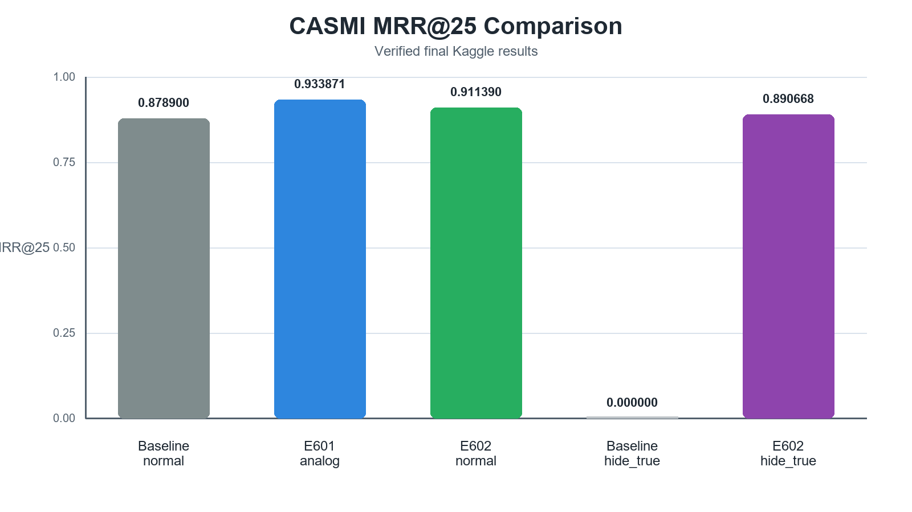

# Hand-off: @Viki2183

Implementation file: `model_analog_coconut.py`. Generated matrices and the
COCONUT table remain local ignored artifacts and are not committed.

## Final executed Kaggle results

The final executed notebook used CPU and the official Enveda CASMI competition
data. The copied notebook is
`Viki2183_CASMI26_Analog_COCONUT_E601_E602_final_executed.ipynb`.

| Experiment | Model / mode | MRR@25 | Top-1 | Top-10 | Top-25 | Molecules | Runtime (s) |
|---|---|---:|---:|---:|---:|---:|---:|
| E601 | Analog search | 0.933871 | 0.904 | 0.992 | 0.996 | 250 | 406 |
| E602 | Analog + COCONUT, normal | 0.911390 | 0.884 | 0.964 | 0.972 | 250 | 451 |
| E602 | Analog + COCONUT, hide_true | 0.890668 | 0.856 | 0.952 | 0.960 | 250 | 444 |

The repository's logged E002 baseline is MRR@25 `0.8789`.



COCONUT validation coverage: **NOT COMPUTED**. It must be computed directly
from the validation set; the verified notebook outputs provide the final model
metrics and the 479,694-row preprocessed candidate count, but not the coverage
percentage.

## Model 1: sparse analog search

For each query spectrum, the scorer bins peaks into 1,000 bins at 1.0 m/z,
stores one L2-normalised row per reference spectrum in a SciPy CSR matrix, and
searches the top 20 rows in the same ionisation mode without a precursor-mass
filter. Each analog's 2048-bit Morgan fingerprint contributes its spectral
similarity times its fingerprint Tanimoto similarity to the candidate. The
weighted sum divided by the similarity sum is the candidate score, with an
optional baseline-cosine blend.

Input -> output: query spectra plus the existing candidate DataFrame -> one
score per candidate. Cached matrices are written below
`data/processed/analog_search/`.

## Model 2: COCONUT expansion

`build-coconut` uses RDKit to calculate neutral monoisotopic mass and
InChIKey14, removes duplicate InChIKey14 values, sorts by mass, and writes a
local `coconut.parquet`. `extra_candidates` returns COCONUT SMILES within
plus/minus 15 ppm of the median neutral mass implied by the query spectra.
The final run used COCONUT version November 2026 with 479,694 unique molecules
after preprocessing.

## Reproducibility

```bash
python -m members.Viki2183.model_analog_coconut smoke
python -m members.Viki2183.model_analog_coconut build-coconut --input path/to/coconut.csv
python -m members.Viki2183.model_analog_coconut evaluate --model analog
python -m members.Viki2183.model_analog_coconut evaluate --model coconut
python -m members.Viki2183.model_analog_coconut evaluate --model coconut --hide-true
```

Model 3 was not run. No source code, raw data, weights, or Kaggle credentials
are included in the hand-off notebook.
