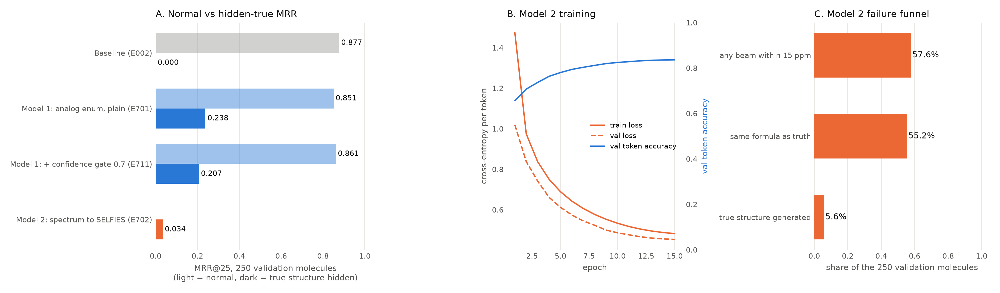

# Hand-off: @YashShevkar30

> Filled in on 28 Nov 2026 (the original deadline was Wed Nov 25, 9 PM, so this is late). Anees copies it into the report and slides. Your task: [TASK.md](TASK.md)

## Models
| # | Model | File | Local MRR@25 (normal) | Top-1 | Top-10 | hide_true MRR | Kaggle score | Exp. ID |
|---|---|---|---|---|---|---|---|---|
| 0 | Baseline (library cosine) | src/models/library_search.py | 0.877 | 0.816 | 0.968 | 0.000 | 0.135 (public) | E002 |
| 1 | Model 1: analog + modification enumeration, confidence gate τ=0.7 (submitted) | model_analog_enum.py | 0.861 | 0.804 | 0.944 | 0.207 | 0.130 (public, below baseline) | E711 (plain: E701) |
| 2 | Model 2: spectrum to SELFIES transformer | model_smiles_transformer.py | not run | not run | not run | 0.034 | pending (ref 59047225) | E702 |
| 3 | Model 3 | not done (optional, skipped) | | | | | | |

Local numbers are on the 250 held-out validation molecules. hide_true removes the true structure from the library, so the baseline scores 0.000 by design and only generated candidates can score.

## Model 1: analog + modification enumeration
- **What it is:** Natural products often come in families, so an unknown molecule is often a known library molecule plus one small chemical change. The model takes the query's neutral mass, finds the best library analogs at the mass minus each modification mass, applies each edit at every possible site, and keeps the products within 15 ppm of the true mass.
- **Input → output:** precursor m/z, adduct, and the spectra (used for the cosine ranking of analogs) → up to about 200 new SMILES candidates per molecule, each with a score.
- **Architecture:** no trained network. Seven RDKit reaction edits (hydroxylation +O, methylation +CH2, demethylation −CH2, hydrogenation +H2, dehydrogenation −H2, glycosylation +hexose, deglycosylation −hexose). Top-3 analogs per edit. Product score = parent analog's cosine. Confidence gate: if the best library cosine is at least τ = 0.7, product weight is 0.3, otherwise 1.0.
- **Training:** none. The library is built from the training structures (2.37 M spectra, 274,506 structures). Runs on CPU in about 0.04 s per molecule. The Kaggle notebook runs in about 12 minutes, with internet off.
- **Result and interpretation:** The true structure is generated for 50.8% of hidden molecules, giving hide_true MRR 0.238 (plain) and 0.207 (with the gate). The normal-mode score drops slightly from the baseline's 0.877 to 0.851 (plain) and 0.861 (gate), because products push some correct library hits down. The gate is the better trade-off. Its τ was tuned on the same 250 validation molecules, so the gain is optimistic.
- **Kaggle public result:** 0.130 for the gated version, which is slightly below the baseline's public 0.135. The local validation set overstates the result: the baseline scores 0.877 locally but 0.135 publicly, so local numbers do not transfer directly to the Kaggle test set. Model 1 did not beat the baseline on the public set. We have not yet checked which public molecules it gained or lost on, so that is not analysed here.

## Model 2: spectrum to SELFIES transformer
- **What it is:** A sequence-to-sequence model that reads the MS/MS peaks and writes the molecule directly as SELFIES tokens. SELFIES always decodes to a valid molecule, so every output can be parsed.
- **What changed vs Model 1, and why:** Model 1 can only produce molecules that are close to the library. Model 2 is meant to propose molecules that are not in any database at all, which is what the hidden Class 3 molecules need.
- **Architecture / training:** Peak encoder with Fourier features of m/z and neutral loss, plus intensity and a metadata token (adduct one-hot, collision energy, precursor mass). 4-layer transformer encoder, 4-layer decoder, d=256, 8 heads, feed-forward 1024, dropout 0.1, 7.5 M parameters, SELFIES vocabulary of 57 tokens. Stereochemistry is removed. Training data: 479,523 spectra from 264,133 structures (at most 2 spectra per structure), with 25,248 validation spectra split by structure (5%). AdamW, lr 5e-4, 1000-step warm-up then cosine decay, batch 256, grad clip 1.0, early stopping patience 3 (not triggered). 15 epochs on a Kaggle T4 GPU, about 368 s per epoch, 99 min total. Decoding: beam search, beam 25, up to 8 spectra per molecule. The weights are uploaded as the private dataset `casmi-yash-weights`.
- **Result and interpretation:** hide_true MRR 0.034, top-1 0.024, top-10 0.052, top-25 0.056. Every beam is a valid molecule (100%), but only 6.9% of valid beams fall within 15 ppm of the true mass, and the true structure is recovered for 5.6% of molecules. The mean best Tanimoto similarity to the truth is 0.38, so the model gets close but rarely exact. Model 2 is weaker than Model 1 on the same test. Full failure analysis is below.

## What didn't work, and why (required)
- **E702, Model 2 (hide_true MRR 0.034):**
  - **What I tried:** a transformer that decodes SELFIES from peaks, trained for 15 epochs, with beam search (beam 25) and a 15 ppm mass filter.
  - **What happened (numbers):** valid 100%, in-mass 6.9% of valid beams, 57.6% of molecules have at least one in-mass beam, 55.2% have the right molecular formula, true structure recovered for 5.6% of molecules, MRR 0.034, mean best Tanimoto 0.38.
  - **Why I think it failed:** (1) The decoder does not condition on the precursor mass, so the mass filter removes about 93% of beams. (2) The model learns general chemistry but rarely reproduces the exact structure. (3) The model is under-trained: validation loss was still falling at epoch 15 (0.4562 at epoch 14, 0.4535 at epoch 15). (4) We used at most 2 spectra per structure to fit the Kaggle time limit.
  - **What I learned / what I'd do next:** Valid SMILES are not the bottleneck; mass control and exact recovery are. The next steps would be mass-conditioned decoding and longer training. These were not done because they are outside the course time.
- **E701, Model 1 normal-mode cost:** the hide_true gain (0.238) costs about 0.026 on normal molecules (0.877 → 0.851), because products push some correct library hits down.
- **E710, flat down-weighting of products:** weights 0.5 and 0.3 protect normal molecules (0.870 and 0.874) but lose about half of the hide_true gain (0.125 and 0.090). This is a plain trade-off, not a fix.
- **E711, confidence gate:** better than flat weighting (hide_true 0.207, normal 0.861), but τ was tuned on the same validation set, so the gain is optimistic.

Other runs: a second local training run of Model 2 (10 epochs on the Mac) was stopped at epoch 5 because the Kaggle run had already finished all 15 epochs with a lower validation loss. It was not used for any result.

## Figure

_Left: normal vs hidden-true MRR for the baseline and both models. Middle: Model 2 training and validation loss, with validation token accuracy. Right: Model 2 failure funnel (share of molecules reaching each stage)._

## Kaggle evidence
Screenshots in `results/leaderboard_evidence/`:
- Model 1 (submission ref 59039219, "E711 analog enumeration gate 0.7"): submitted 28 Nov 2026. Public score **0.130**, below the baseline's 0.135. The screenshot still needs to be added to `results/leaderboard_evidence/`.
- Model 2 (submission ref 59047225, "E702 spectrum-to-SELFIES transformer"): submitted 28 Nov 2026 from kernel `casmi-yash-model2-submit` v1. The public score is pending at the time of writing. The screenshot still needs to be added to `results/leaderboard_evidence/`.
