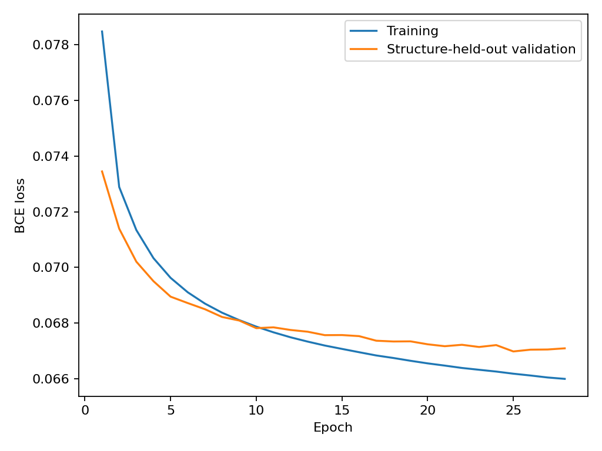
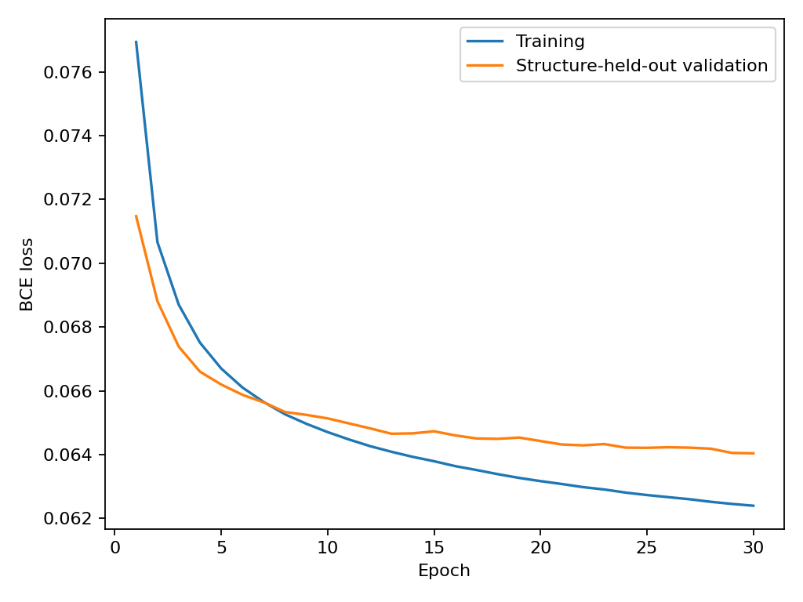
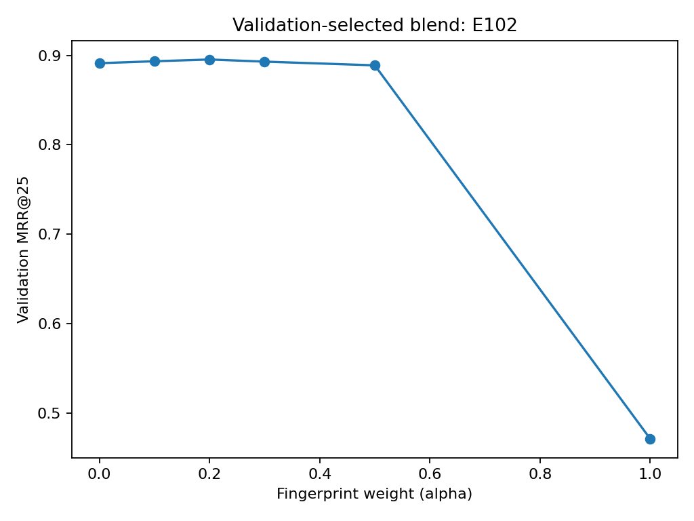
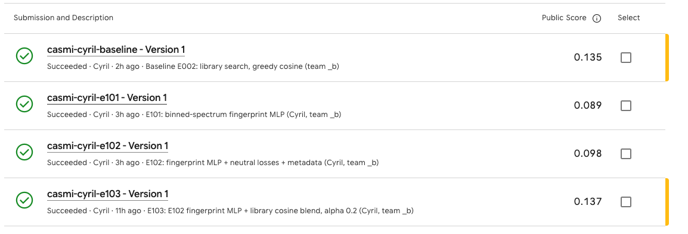

# Cyril: spectrum → fingerprint MLPs

Both models completed final Colab training on November 25, 2026 (America/Los_Angeles), using 699,550 training spectra and 36,766 spectra for early stopping. Evaluation covers all 250 shared validation molecules. E102 improved standalone MRR@25 over E101 (0.471017 vs 0.418836); the best blend, E102 with alpha 0.2, reached **0.895501**, versus the measured library baseline of **0.891360**. On the Kaggle public leaderboard (team GROUP_PROGRAMMING_01_b, November 27) E103 scored **0.137**, the library baseline 0.135, E102 0.098 and E101 0.089; see [Kaggle results](#kaggle-results).

Final metrics, histories, per-molecule ranks, environment details, and figures have been downloaded from [Drive's final output folder](https://drive.google.com/drive/folders/1BJxOEuvXe0cpuYjxb61mm64zl6jWhqOx) into [final_results/](final_results/). The [download manifest](final_results/download_manifest.json) records each source URL, modification time, byte count, and SHA256. Best checkpoints are stored locally under the git-ignored `weights/final/E101/best.pt` and `weights/final/E102/best.pt`; their hashes match the training and evaluation reports. Existing model notebooks retain their saved outputs and were not edited during this hand-off update. Earlier smoke results remain in [smoke_results.json](smoke_results.json).

## Reproducing final training

Run `01_fingerprint_mlp.ipynb`, then `02_losses_metadata_mlp.ipynb`, from the first cell in Cursor with a Colab GPU kernel. Use the same Colab environment for both, and restart the kernel after any source update. Project files and outputs stay on Drive. The source folder must include `baseline_audit.py` alongside `model_mlp.py` and `kaggle_data.py`.

Both notebooks default to `STAGE='final'`: all eligible spectra, at most three per structure, up to 30 epochs, batch 256, Adam lr 0.001, seed 0, and patience 3 on the separate 5% structure split. Final outputs go to `cyril/final`; smoke outputs remain in `cyril/smoke`. A partial final run resumes automatically when its `last.pt` exists. `CASMI_RESUME=false` explicitly requests a fresh run and will refuse to overwrite an existing checkpoint. The helper rejects sampled caches in final mode.

The baseline cell checks the training-file hash against the reference manifest, measures both baseline ranking paths, and saves source/version/reference identities and per-molecule ranks under `final/baseline_audit`. A later notebook run refuses changed candidate scores or baseline context. If that happens, restore the original environment or set a new `CASMI_OUTPUT` and rerun both models there. The baseline audit must finish before building the final feature cache or training.

Use a high-RAM runtime. Feature files alone use about 7.5 GB at 740,000 rows, and the shared training loader also holds the spectra in RAM. The first baseline audit hashes the complete training parquet and reference files; Drive reads can take several minutes. After E101 finishes, E102 reuses the same cache and split. Its last cells evaluate all four blends, package final weights, and export hand-off figures and measured results. Uploading to Kaggle and submitting remain separate actions.

## Baseline discrepancy

Saved Colab baseline: **0.891360 MRR@25**. A fresh macOS evaluation of the same Drive reference with identical shared source measured **0.878976**; the original frequency-bonus ranking measured **0.879643**. These are different from the historical E002 log value of 0.8789. The frequency bonus alone does not explain the Colab difference.

The shared reference loader groups spectra with an unstable sort, then scores only the first 50 reference spectra per candidate. Changing only the within-structure order to a stable sort produced **0.901361** locally. A synthetic test also demonstrates that moving a matching spectrum across that cutoff changes the score. This establishes sensitivity to reference order; the exact NumPy/platform contribution to Colab's value has not been isolated. Colab used NumPy 2.4.6 / pandas 2.2.3 / PyArrow 23.0.1; the local probe used 2.4.2 / 3.0.5 / 25.0.1.

Shared source is unchanged. All final model comparisons use their own measured shared baseline in the same verified context. The stable-sort number is a diagnostic, not a replacement baseline or an improvement attributed to the MLP. Reproduction code is [baseline_audit.py](baseline_audit.py), including the optional `--order-sensitivity` probe. A shared-code fix should be coordinated with Anees before the whole team changes its evaluation protocol.

The full local training-parquet SHA256 matched the saved reference manifest. Measured audit details, file/source hashes, environment versions, and per-molecule comparisons are saved in [baseline_investigation/audit.json](baseline_investigation/audit.json) and [baseline_investigation/reference_order.json](baseline_investigation/reference_order.json). The final Colab audit is saved in [final_results/baseline_audit/audit.json](final_results/baseline_audit/audit.json). It measured 0.891360 for both ranking paths; the E103 recheck preserved the baseline context. Final GPU training and evaluation have completed.

## Run in Cursor with a Colab kernel

The configured project root is `My Drive/Data266/EnvedaGroupProject`:

```text
EnvedaGroupProject/
├── repo/
│   ├── src/                         # complete shared Python source
│   ├── members/mrcyrilgoud/         # model, download helper, tests, README
│   └── data/raw/
│       ├── train.parquet           # required for training and validation
│       ├── test.parquet            # downloadable example test (not hidden test)
│       └── sample_submission.csv
└── cyril/                          # generated files, created automatically
```

1. Open the local `members/mrcyrilgoud/01_fingerprint_mlp.ipynb` in Cursor and select your Colab GPU kernel. Notebook files stay in the local repository; the Drive copies have been removed. Drive still holds the remote Python source, competition data, caches, checkpoints, and results.
2. No manual competition-file upload is needed. On the first run the notebook uses the official `kagglehub` API client to download all three files directly to `repo/data/raw/`. Use the first `ENV_VALUES` cell to inject runtime environment variables. The token entry is commented out by default so cached-data runs also work through the Colab CLI. If a download is needed, enable `"KAGGLE_API_TOKEN": None` to request a hidden prompt, or use an existing environment value. String values are injected directly. Add other environment names and values to that dictionary as needed. Your account must already have joined/accepted the competition rules; the notebook does not accept terms automatically. Never enter literal tokens into the saved notebook. The previously saved token has been removed from the local notebooks; its owner still needs to rotate it.
3. Run from the environment cell with the default `STAGE='final'`. Mount Drive when prompted by the Colab extension. Code runs directly from Drive; there is no local repository copy or training-file symlink. The configuration cell contains the exact project paths. Optional overrides from `ENV_VALUES` are `CASMI_DRIVE_MOUNT`, `CASMI_PROJECT`, `CASMI_OUTPUT`, `CASMI_STAGE`, and `CASMI_RESUME`.
4. Open the local `02_losses_metadata_mlp.ipynb` in Cursor and run it with the same stage. It reuses the cached rows, fingerprints, and structure split and evaluates the blend.
5. For a new smoke/debug check, override `CASMI_STAGE` explicitly. Stages use 2,000, 200,000, and all eligible spectra, capped at three per structure; epochs are 2, 3, and up to 30 respectively. Use a new output root when revisiting old runs made without a baseline audit.
6. Interrupted final runs resume automatically. After changing Python source, restart the runtime and rerun from the first cell. An already early-stopped run remains stopped.

Raw data and code stay in `repo`; reference files, feature caches, checkpoints, reports, upload staging, temporary files, and package caches stay under `cyril`. `/content/drive` is only the Google Drive mount point. Colab's interpreter and installed runtime libraries are managed by Colab; project data is not copied to local `/content` storage.

Downloads are staged and validated before being placed at the canonical paths. Existing valid files are reused without authentication; interrupted or invalid files are downloaded again. API/network failures stop setup with a rerun instruction. See [official Kaggle API client documentation](https://github.com/Kaggle/kagglehub#download-competition).

The first reference build uses the full training parquet, even for smoke mode. Cache building holds the shared loader's DataFrame in memory; use a high-RAM runtime if needed. Both dense feature variants occupy roughly 7.5 GB for 740,000 spectra, in addition to targets, raw data, and reference files. Direct Drive I/O can be slower than local Colab disk.

## Models

| Experiment | Input | Architecture | Status |
|---|---|---|---|
| E101 | 1,000 spectrum bins | 1000 → 1024 → 1024 → 2048 | Final trained and validated |
| E102 | Spectrum + 500 neutral-loss bins + 12 metadata values | 1512 → 1024 → 1024 → 2048 | Final trained and validated |
| E103 | Better standalone MLP + library cosine | Weighted score blend | Final sweep and baseline recheck complete |

Both networks use ReLU and dropout 0.3 after each hidden layer. Training uses Adam, learning rate 0.001, batch size 256, BCEWithLogitsLoss, and seed 0. The 5% early-stopping split is by InChIKey14, with patience 3. Every structure in the shared `enveda-np-examples` validation set is excluded from both training splits, including its appearances in other libraries. Model 2 changes only the input features.

Targets are 2,048-bit radius-2 Morgan fingerprints, cached once per unique SMILES as uint8. Features use the shared loader's already cleaned intensities. Neutral losses are restricted to `[0, 500)` before binning. Missing collision energy follows the shared metadata helper's zero encoding.

At inference, sigmoid probabilities are averaged across the molecule's spectra before Tanimoto comparison with each candidate's fingerprint. E103 selects the better standalone model (ties favor E101), then searches alpha 0.1, 0.2, 0.3, and 0.5 (ties favor smaller alpha). The curve includes baseline and standalone endpoints. Blend selection uses the same shared validation set and is not an independent test estimate.

## Results and hand-off

The MRR and top-k columns are final Colab validation measurements, retrieved directly from Drive. All rows share the same reference, candidate protocol, and 250 validation molecules. The historical 0.877–0.8789 figures are not substituted for the measured baseline. The Kaggle column is the public-leaderboard MRR@25 of team _b's submissions; see [Kaggle results](#kaggle-results).

| Model | MRR@25 | Top-1 | Top-10 | Top-25 | Kaggle (public) |
|---|---|---|---|---|---|
| Library cosine | 0.891360 | 0.836 | 0.976 | 0.992 | 0.135 |
| E101 | 0.418836 | 0.260 | 0.756 | 0.884 | 0.089 |
| E102 | 0.471017 | 0.296 | 0.812 | 0.908 | 0.098 |
| E103 (E102, alpha 0.2) | **0.895501** | **0.844** | **0.980** | **0.996** | **0.137** |

**E101 — spectrum MLP.** The 1,000-bin input feeds a 1000 → 1024 → 1024 → 2048 network. Training used all 736,316 eligible cached spectra across 267,026 structures, with 699,550 training and 36,766 early-stopping spectra. It stopped after 28 epochs, selecting epoch 25 (validation BCE 0.066980); recorded training time was 931 seconds on a Tesla T4. See [training report](final_results/E101/training.json) and [validation metrics](final_results/E101/evaluation/metrics.json).

**E102 — spectrum, neutral losses, and metadata.** The 1,512-feature input feeds a 1512 → 1024 → 1024 → 2048 network. It used the same rows, structure split, optimizer, and training settings as E101. It completed the 30-epoch limit and selected epoch 30 (validation BCE 0.064042); recorded training time was 17,837 seconds on a Tesla T4. MRR improved by 0.052181 over E101, although it remained below library cosine. See [training report](final_results/E102/training.json) and [validation metrics](final_results/E102/evaluation/metrics.json).

Both runs used Adam lr 0.001, batch 256, seed 0, BCEWithLogitsLoss, dropout 0.3, and patience 3. The recorded environment was Python 3.13.16, PyTorch 2.14.1+cu130, NumPy 2.4.6, pandas 2.2.3, RDKit 2026.09.2, and PyArrow 23.0.1; see [environment.json](final_results/environment.json).

**E103 — blend.** E102 was selected as the better standalone model. The blend uses `alpha * fp_score + (1 - alpha) * cosine`; alpha 0.2 improved MRR by **0.004141** over the measured baseline. The separate E103 notebook repeated the sweep and verified the saved baseline context. Alpha selection and reporting use the same validation set, so this gain is not an independent test estimate. See [selection](final_results/E103/selection.json), [curve CSV](final_results/E103/blend_curve.csv), and [selected-blend metrics](final_results/E103/0.2/metrics.json).

| Fingerprint weight alpha | MRR@25 |
|---|---|
| 0 (library baseline) | 0.891360 |
| 0.1 | 0.893519 |
| **0.2** | **0.895501** |
| 0.3 | 0.893105 |
| 0.5 | 0.888956 |
| 1 (E102 alone) | 0.471017 |







Each stage saves `baseline/metrics.json`; each experiment saves `best.pt`, resumable `last.pt`, `training.json`, `history.json`, a training curve, and `evaluation/{metrics.json,per_molecule.csv}`. The training report records actual data counts, epochs, hardware, runtime, versions, configuration, and checkpoint hash. Cache manifests record source/code hashes, row identities, and split identifiers. Checkpoint inference requires the exact model and shared feature/loader source used in training. Blend selection validates both checkpoints, their split/cache identities, and the shared evaluation protocol before comparing scores. Packaging also requires the evaluations and both checkpoints to match the saved blend selection. Reevaluate after resuming training; artifacts from the earlier implementation lack these identity fields and must be regenerated.

The second notebook exported the [original hand-off report](final_results/handoff/results.md), figures, and Kaggle upload package. That downloaded report is preserved as generated, including its draft experiment-log rows; the reviewed, dated final rows are now in [the shared experiment log](../../experiments/experiment_log.md). The local results folder includes both models' histories, training reports, evaluation metrics and per-molecule ranks; baseline metrics and audit; all four blend evaluations; and the E103 baseline recheck. Raw data, dense feature caches, reference arrays, and resumable `last.pt` checkpoints remain on Drive. The two inference checkpoints were downloaded separately into the ignored weights folder.

**What did not work:** the fully trained standalone MLPs remained well below library cosine: E101 scored 0.418836 and E102 scored 0.471017, versus 0.891360. Richer features helped relative to E101, but did not close that gap. Validation compounds also occur in the reference library through other acquisitions, which favors direct spectral matching; compressing spectra into fingerprint probabilities may also lose discriminative information. These are plausible explanations, not causes isolated by an ablation. The useful outcome is complementary evidence: a small E102 contribution improved validation MRR, while alpha 0.5 reduced it to 0.888956. Earlier two-epoch smoke runs also underperformed and are documented separately in [smoke_results.json](smoke_results.json).

These models only rerank supplied candidates and cannot recover absent structures. No `hide_true` claim is appropriate without candidate expansion.

### Kaggle results

All four runs were submitted by team GROUP_PROGRAMMING_01_b on November 27, 2026 (America/Los_Angeles), from private Kaggle notebooks run on CPU with internet off. Scores are public-leaderboard MRR@25; the private score is not shown yet. Each submission is logged in [the submission log](../../submissions/submission_log.md).

| Submission | Kaggle notebook (v1) | Public MRR@25 | Local MRR@25 |
|---|---|---|---|
| E103 (E102 + cosine, α 0.2) | `mrcyrilgoud/casmi-cyril-e103` | **0.137** | 0.8955 |
| Library baseline (E002) | `mrcyrilgoud/casmi-cyril-baseline` | 0.135 | 0.8914 |
| E102 alone | `mrcyrilgoud/casmi-cyril-e102` | 0.098 | 0.4710 |
| E101 alone | `mrcyrilgoud/casmi-cyril-e101` | 0.089 | 0.4188 |

The leaderboard ranks the four in the same order as local validation, but the scores are far lower: about 6.5 times below their local values for the library methods and 4.8 times below for the MLPs. Local validation contains only Class 1 molecules, while on Kaggle the candidates come only from training structures, so a test molecule whose structure is not in the training set scores 0 under every one of these pipelines. Team _a's identical baseline also scored 0.135. E103's +0.002 over the baseline is inside the leaderboard noise (about ±0.02 with roughly 124 public molecules): E103 and the baseline choose the same top-1 structure for all 400 test molecules and differ only lower in the list. E102 beats E101 by 0.009, the same direction as locally, but also within noise. On November 27 the team's best score, 0.137, ranked 5,544 of 6,173 teams.



## Offline Kaggle submission

The second training notebook packages `model_mlp.py`, E101/E102 checkpoints, training metadata, blend selection, and checksums into Drive's `kaggle_upload/casmi-cyril-weights`. Upload the folder as a private dataset; no upload or submission happens automatically.

Import `03_kaggle_submission.ipynb`. Attach competition data, `casmi-team-src` from the same shared-code revision as training, your weights dataset, and compatible offline RDKit wheels if needed. Set Internet OFF. Select `EXPERIMENT='E101'`, `'E102'`, or `'E103'` in its configuration cell. If file discovery is ambiguous, set explicit input paths. The notebook verifies packaged checksums, loads CPU weights, builds the reference, writes `/kaggle/working/submission.csv`, and checks IDs and guesses. It never trains or downloads dependencies from the network. Run a fresh saved Kaggle version before submitting and recording its actual score.

The submitted runs attached the datasets `mrcyrilgoud/casmiteamsrc` (shared code, `casmi_src/src/`), `mrcyrilgoud/casmi-cyril-weights` (the packaged folder above) and `tngmai20042005/casmi26-offline-rdkit-2026033` (RDKit 2026.3.3 wheels; Kaggle's image runs Python 3.13, so cp312-only wheel sets fail). The E101 and E102 notebooks are copies of the E103 one with only `EXPERIMENT` changed. The baseline notebook is the repo's unchanged [`kaggle/library_search_baseline`](../../kaggle/library_search_baseline/notebook.ipynb) and needs only the competition data. Each run took 10–13 minutes, mostly building the reference from `train.parquet`. The E101–E103 notebooks check their 400-row `submission.csv` (molecule IDs, 1–25 guesses, RDKit-parsable SMILES); the baseline notebook does not, so its output was checked after download for IDs and guess counts.

## Local verification

The hand-off update verified all 33 downloaded files against their byte counts and recorded SHA256 values, checked both checkpoint hashes against training/evaluation/selection metadata, and recomputed MRR and top-k accuracy from all seven 250-molecule ranking tables. Training histories agree with the reported epoch counts and best epochs, model source hashes match the training reports, and all three copied figures were visually inspected. All existing notebook files remain byte-for-byte unchanged. These checks inspect saved artifacts; they do not rerun training or Kaggle inference.

From the repository root with the project requirements installed:

```bash
MPLBACKEND=Agg python -m unittest discover -s members/mrcyrilgoud -p 'test_*.py' -v
```

Tests use synthetic spectra and real RDKit fingerprints. They cover feature/loss boundaries, leakage exclusion, cache corruption, decreasing training loss, exact epoch-resume parity, best-checkpoint reload, both scorer variants, candidate ordering, probability aggregation, invalid SMILES, empty candidates, shared evaluation, blend selection ties, artifact packaging, figures, and submission generation. Regression coverage also exercises Drive-only setup and environment-value injection, source-change restart checks, stale metrics/packaging, split/protocol mismatches, and recorded hand-off hyperparameters. Final-setup checks cover real-parquet baseline auditing, the first-50 ordering sensitivity, baseline-context changes, final-stage defaults, and rejection of sampled final caches. On November 26, with RDKit installed (Python 3.9.6, RDKit 2025.09.2, PyTorch 2.8.0, NumPy 2.0.2), all 26 tests passed. Notebooks 01 and 02 keep their saved outputs as final-run evidence; the final-stage notebook test allows them but fails if any saved output contains a Kaggle token. These software checks are separate from the completed Colab training/validation and do not establish a successful offline Kaggle run.
